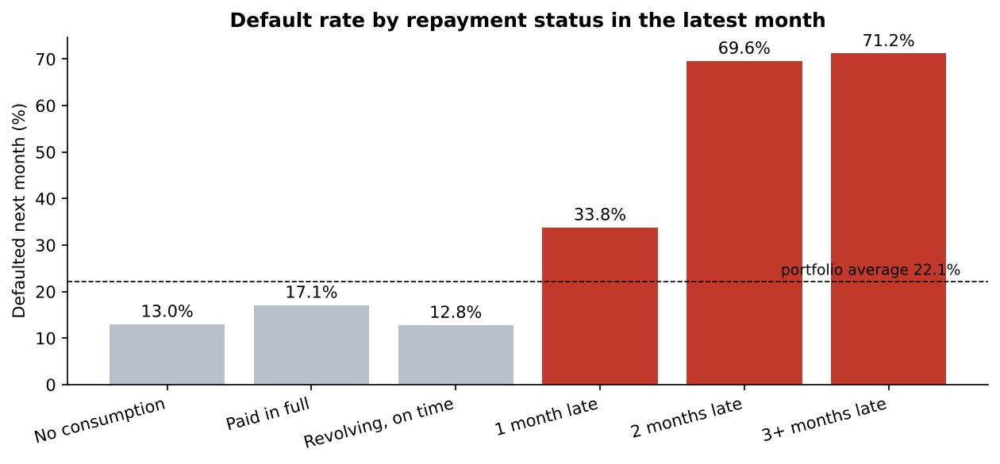
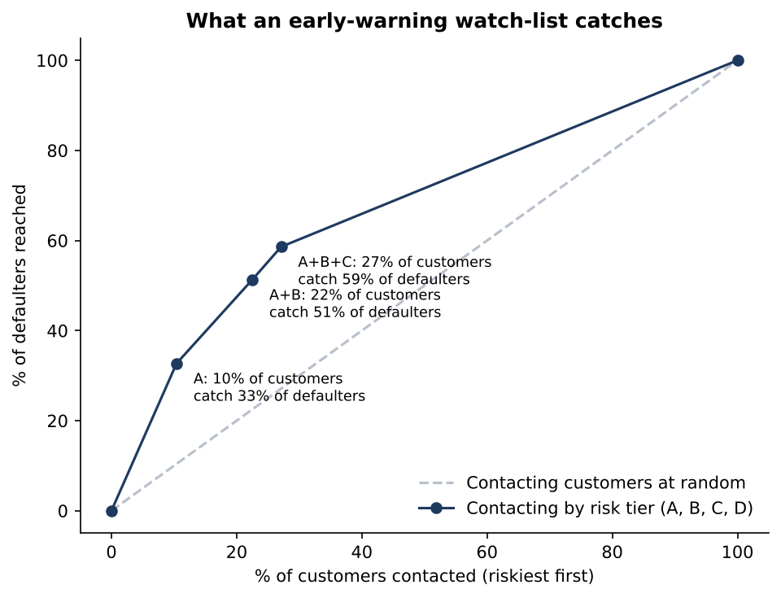
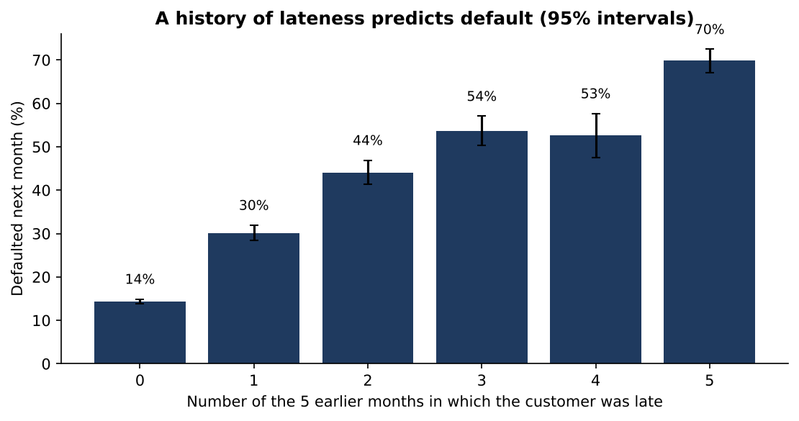
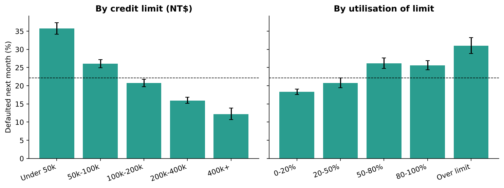
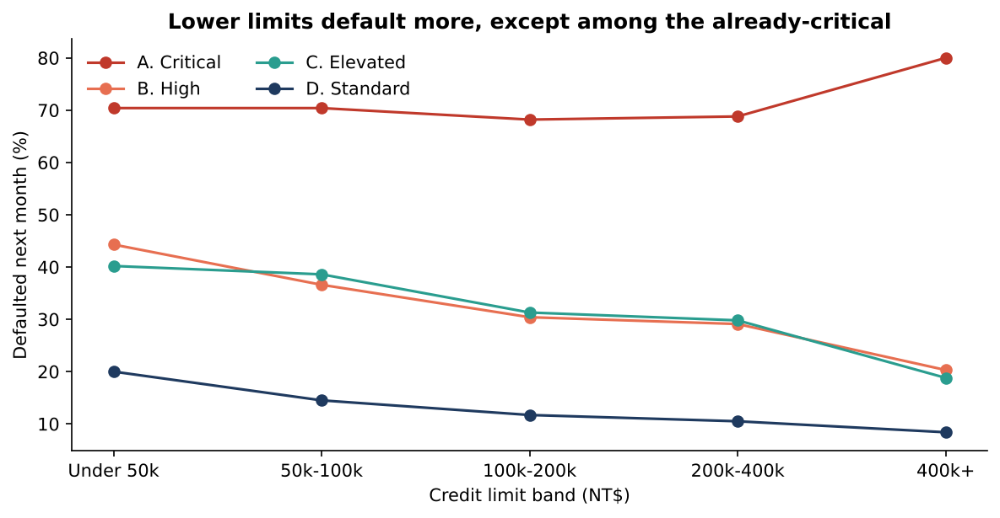

# Credit-Card Default Risk: Who Do We Call First?

**SQL (cleaning & analysis) · Power BI (dashboard) · Python (pipeline & charts)**

A bank's credit-card book had **24,000 customers, NT$1,227 million in outstanding balances, and 22% of customers defaulted the following month**. This project asks the question a credit-risk or collections team asks every month: *how early can we see default coming, and who should the bank act on first?*

---

## 1. The business question

> **Collections teams can only contact so many customers. Which customers should the bank flag for early action, how many future defaulters would that reach, and what does credit limit tell us?**

Sub-questions:

1. How big is the problem, in customers and in money?
2. How early are the warning signs visible?
3. Can simple, explainable rules build a watch-list, and how many defaulters does it catch for how many customers contacted?
4. Do credit limit, utilisation and demographics add anything, and which of those *should* a lender be allowed to use?

## 2. The data

| | |
|---|---|
| Source | UCI *Default of Credit Card Clients*: Yeh & Lien (2009), a Taiwanese bank's credit-card customers. Licence CC BY 4.0. |
| Copy used | 24,000 customers (a subset of the original 30,000) as distributed in PyCaret's sample datasets on GitHub |
| Coverage | Monthly repayment status, bill and payment amounts for **April to September 2005**; outcome = default in **October 2005** |
| Currency | New Taiwan dollars (NT$), not rands |
| Outcome | `default`: 22.1% of customers (5,306) |

## 3. What I did to the data (SQL)

The full pipeline is in [`sql/`](sql/) and runs end-to-end with `python scripts/build_database.py`.

| Step | File | What happens |
|---|---|---|
| 1 | `01_staging.sql` | Raw landing table, all text, untouched |
| 2 | `02_clean_transform.sql` | Typed, relabelled, behaviour features and risk tiers built |
| 3 | `03_data_quality_checks.sql` | 10 checks; all behave as expected |
| 4 | `04_analysis_tables.sql` | Report tables, exported as CSV for Power BI |

**Cleaning decisions and data-quality findings:**

- **Undocumented codes:** the repayment status uses -2, -1 and 0, which the file does not explain. I relabelled them using the dataset authors' definitions (no consumption, paid in full, revolving credit on time). Education codes 0/5/6 (267 customers) and marital code 0 (42 customers) are not defined at all, so they are labelled "Unknown" rather than guessed.
- **Negative bills (455 customers in the latest month)** are customers who overpaid and are in credit. I kept them and floored balances at zero for exposure measures.
- **24 exact duplicate rows were kept, not deleted.** With no customer ID, identical rows can be different people, and 87% of them are zero-activity profiles that plausibly repeat. They are flagged in the checks.
- **Inconsistent coding of "1 month late".** The status "1 month late" appears **2,907 times in the latest month but only 24, 4, 2, 0 and 0 times in the five months before**, while "2 months late" appears 2,000-3,000 times in every month. The earlier months were evidently not coded the same way. So "months late" history effectively counts months that were **2+ late**, and I only use the latest month to identify the "1 month late" group.
- **Demographics are kept for description, not for rules.** Sex, marital status and education are in the data, but the risk tiers use repayment behaviour only (see Finding 6).

## 4. What I found



### Finding 1: Default is concentrated, and obvious by the time customers are 2 months late
Overall, **22.1% of customers (5,306) defaulted, holding NT$258 million of NT$1,227 million balances (21.1%)**. But the risk is far from even. Customers who were **2+ months late** in the latest month defaulted **70%** of the time (69.6% at 2 months, 71.2% at 3+). Customers who were 1 month late defaulted **33.8%**, and customers paying normally **12.8%**.

### Finding 2: Three simple rules build a watch-list that reaches 59% of defaulters with 27% of the contacts

| Tier | Rule | Customers | Default rate | % of customers | % of defaulters |
|---|---|---|---|---|---|
| A. Critical | 2+ months late last month | 2,485 | 69.9% | 10.4% | 32.7% |
| B. High | 1 month late last month | 2,907 | 33.8% | 12.1% | 18.5% |
| C. Elevated | Not late now, but 2+ earlier late months, or **paid nothing last month** while owing | 1,119 | 34.9% | 4.7% | 7.4% |
| D. Standard | None of the above | 17,489 | 12.6% | 72.9% | 41.4% |



Contacting tiers A+B+C means contacting **27% of customers to reach 59% of all defaulters**, a lift of 2.2x over contacting at random. Tier A alone is 10% of customers for 33% of defaulters (lift 3.2x). The tiers behave consistently when the data is split into two random halves (tier A: 70.3% vs 69.4%; B: 35.1% vs 32.6%; C: 34.6% vs 35.1%; D: 12.1% vs 13.0%).

### Finding 3: Tier C finds risk that a simple "days late" report cannot see
1,119 customers look **current** on paper, but have either been late in at least two earlier months (975 customers) or **paid nothing last month despite owing money** (297 customers, 153 in both groups). They default at **34.9%**, nearly 3x the standard tier. Across the whole book, the 1,760 customers who paid nothing on a balance defaulted **52.3%** (95% CI 50.0-54.7%).



A history of lateness is a steady warning signal: **14.4%** default for customers never late before, rising to **30.2%** (1 earlier late month), **44.1%** (2) and **69.9%** (late in all 5 earlier months).

### Finding 4: Credit limit and utilisation add information, but limit is not a lever


Customers with limits under NT$50k defaulted **35.8%** versus **12.2%** for limits over NT$400k, and defaulters had much lower limits (median NT$90k vs NT$150k). Customers over their limit defaulted at **31.0%** versus 18.3% for those using under 20% of their limit.



Within behaviour tiers the limit effect remains (standard tier: 20.0% for limits under 50k vs 8.4% for 400k+), but among Critical customers it largely vanishes: they default at 68-70% at every limit up to NT$400k (the 400k+ group is only 60 customers, at 80%). **Important caution:** limits are set by the bank, probably *because* it judged some customers riskier. A low limit is therefore a sign of risk the bank already saw, not a cause of default, so raising limits will not reduce defaults.

### Finding 5: Where the money is
Tier A holds NT$158.6m of balances, of which **NT$111.8m (70.5%) belonged to customers who defaulted**. But tier D, which looks safe, still contains **NT$105.1m, or 41% of all defaulted balances**, spread over 17,489 customers. Simple behaviour rules catch the obvious cases and miss many others.

### Finding 6: Demographics show gaps, but they should not be used to decide
Men defaulted at 24.3% versus 20.7% for women, and married customers at 23.5% versus 20.9% for single. Education groups also differ. I show these in the dashboard **for fairness monitoring only**. Many jurisdictions prohibit using sex or marital status in credit decisions, and the behavioural rules above already capture the strongest risk signals without them.

## 5. What I would recommend

| # | Recommendation | Evidence |
|---|---|---|
| 1 | **Act on tier B (1 month late) as the main intervention window**: automated reminders, an easy payment plan, a call. Once customers reach 2+ months late, 70% default | 2,907 customers at 33.8% vs 69.9% in tier A. By tier A it is largely too late |
| 2 | **Send tier A straight to collections or restructuring** and prioritise by balance | 10.4% of customers, NT$158.6m of balances, 70% default |
| 3 | **Add tier C to the watch-list**: flag customers who pay nothing on a balance or have repeated earlier lateness, even if they look current | 1,119 customers at 34.9%; invisible to a "days late" report |
| 4 | **Freeze limit increases for tiers A-C** and tighten limits for customers over limit; do not treat low limits as a fix | Over-limit customers default at 31.0%; limit reflects prior risk assessment |
| 5 | **Keep sex and marital status out of rules**; use them only to monitor whether outcomes differ across groups | Strong behavioural signals make them unnecessary |
| 6 | **Pilot before rolling out**: treat tier B with the new approach, hold a control group, and compare default rates. Track tier default rates monthly | The associations here are observational, not proof that intervention works |

## 6. Limitations (read before quoting any number)

- **One bank, one period, one country:** Taiwan, 2005, in NT$. Behaviour, products and regulation have changed since.
- **Observational data:** being 2 months late *predicts* default; this analysis does not show that any action *prevents* it.
- **Rule-based tiers were chosen after looking at this same data** (in-sample). The two-halves check shows they are stable but is not a true out-of-time validation, and there is no date to split on.
- **Tiers miss 41% of defaulters** (tier D). A proper scoring model could do better; it is not built here.
- **Balance is not loss.** Defaulted balance is a proxy for exposure. There is no data on recoveries, interest, fees or collection cost.
- **One-month horizon only:** the outcome is default the next month.
- **Data coding quirks** (inconsistent "1 month late", undefined codes) limit how far the six-month history can be trusted. Customers marked "paid in full" defaulted more (17.1%) than those revolving on time (12.8%). I cannot explain this from the data and would ask the bank how that status is recorded.
- **Subset of the original:** 24,000 of 30,000 customers.

## 7. What I would do next
1. Build a scorecard or logistic model on behaviour features and validate it on a time-based hold-out.
2. Add loss data (recoveries, collection cost) to turn default rates into expected loss in money.
3. Run the pilot in recommendation 6 and measure whether intervention actually reduces defaults.

## 8. Dashboard (Power BI)

Built from the CSVs in `data/processed/`. Steps, DAX measures and page layouts are in [`powerbi/`](powerbi/):

- `BUILD_GUIDE.md`: model, five pages, and a checklist of numbers the report should reproduce
- `measures.dax`: all measures, including confidence intervals and a "watch-list depth" what-if
- `theme.json`: colour theme

## 9. Repository layout
```
data/raw/            original file, untouched
data/processed/      clean customer table and report tables (Power BI inputs)
sql/                 01 staging, 02 cleaning, 03 quality checks, 04 analysis tables
scripts/             build_database.py (pipeline), make_charts.py (README charts)
powerbi/             DAX measures, theme, build guide (+ your .pbix)
images/              charts and dashboard screenshots
docs/                data dictionary
```

## 10. Reproduce it
```bash
pip install -r requirements.txt
python scripts/build_database.py    # raw CSV -> SQLite -> clean tables -> CSVs
python scripts/make_charts.py       # README charts
```
The SQL is written for SQLite. For **SQL Server**: replace `CREATE TABLE ... AS SELECT` with `SELECT ... INTO`, the multi-argument `MAX(a, b, ...)` with `GREATEST` (SQL Server 2022+) or `CASE`, and load the CSV with `BULK INSERT`. For PostgreSQL use `GREATEST` and `COPY`.

## Author
**Katlego Kgotlabeng**: final-year BCom Statistics student, North-West University.
